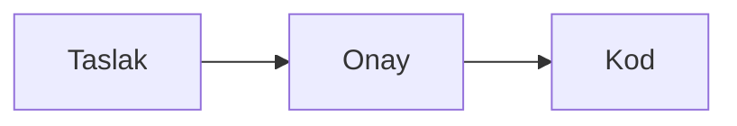

# Notta diyagram ve callout (taslak)

Durum: 20 Ekim 2026. Alexandrie karşılaştırmasından çıktı; kullanıcı bu iki iş için taslak istedi. Onaylanmadı, kod yazılmadı, PLAN'a işlenmedi. Karar bekleyenler 10. bölümde.

## 1. Neden

- Ajan (Claude Code) mimariyi ve akışları ` ```mermaid ` bloğu olarak, önemli notları GitHub'ın uyarı bloklarıyla (`> [!WARNING]`) yazıyor. Scrawl'da bugün ilki düz bir kod bloğu, ikincisi başında `[!WARNING]` yazan bir alıntı olarak görünüyor.
- İki biçim de yerleşik markdown uzantısı: GitHub, GitLab ve Obsidian aynı dosyayı çiziyor. Dosya her yerde okunur kalır, yeni bir biçim uydurulmaz.
- Sunucu istemez; masaüstünde, web'de ve telefonda aynı çalışır (entegrasyon kuralı).
- Kart açıklaması, yorum ve kayıt gövdesi notun editörünü kullandığı için ikisi oralarda da çalışır.

## 2. Callout

### Dosyada

```
> [!WARNING]
> Yedek almadan güncelleme.
```

- Beş tür, GitHub'ınkiler: `NOTE`, `TIP`, `IMPORTANT`, `WARNING`, `CAUTION`. Büyük küçük harf fark etmez; Obsidian `[!note]` diye yazar, o da olur.
- İşaret ilk satırda tek başınadır. Yanında yazı olan (`> [!NOTE] Başlık`, Obsidian'ın özel başlığı) ya da bu beşinin dışındaki bir tür (`[!INFO]`) bugünkü gibi alıntı kalır; GitHub da onları alıntı olarak gösterir.
- Yalnız en üst düzeyde olur; liste ya da başka bir alıntı içindeki callout alıntı kalır. GitHub da iç içe callout çizmez.

### Ekranda

- Sol kenarda türün renginde bir çizgi ve hafif renkli zemin. İlk satırda türün simgesi ve adı: Note, Tip, Important, Warning, Caution. `>` işaretleri bugünkü alıntıdaki gibi gizlidir.
- Renkler temadan gelir: Note mavi, Tip yeşil, Important mor, Warning sarı, Caution kırmızı; her tema kendi tonunu verir.
- Başlık satırına yazılmaz: imleç o satıra girmez, yukarıdan gelen imleç bir sonraki satıra geçer. Böylece yazılan şey işaretin yanına düşüp callout'u bozmaz.
- İçinde liste, kod bloğu, link ve resim olabilir; alıntı gibi davranır.
- Markdown görünümünde dosya olduğu gibi görünür.

### Ekleme ve değiştirme

- Biçim çubuğunda Quote'un yanında Callout düğmesi. Basınca beş türün listesi açılır; seçilen satırlar o türde bir callout olur. Seçim yoksa imlecin satırı olur; boş satırda boş bir callout açılır ve imleç içine geçer.
- `/` menüsünde Callout: Note türünde açar.
- Başlığa tıklamak aynı listeyi açar: tür değişir. Listenin en altında Remove callout vardır; satırlar düz metne döner, işaret satırı ve `> `'ler kalkar.
- İmleç bir callout'tayken düğme seçili görünür, listede şimdiki tür işaretlidir.
- Enter bugünkü alıntıdaki gibidir: satır callout içinde devam eder, boş satırda Enter callout'tan çıkar.
- Klavyeden yazılan `[!NOTE]` callout yapmaz: yazılan yazıldığı gibi kalır, köşeli parantezler kaçırılır. Callout düğmeden ya da dışarıdan (ajan, GitHub'dan gelen dosya) gelir.
- Telefonda format bar'da Callout simgesi; sheet'te beş tür, callout içindeyken Remove callout da. Başlığa dokunmak aynı sheet'i açar.

## 3. Diyagram (Mermaid)

### Dosyada

````

````

Bilgi satırı `mermaid` olan kod bloğu; büyük küçük harf fark etmez. Yalnız en üst düzeydeki bloklar çizilir; liste ya da alıntı içindeki blok kod bloğu olarak kalır. Tablolar da böyledir: çizim satırların tamamının yerini alır.

### Ekranda

- Kodun yerinde diyagram çizilir. Kendi doğal boyutunu geçmez; notun genişliğinden büyükse genişliğe sığdırılır.
- Renkler ve yazı tipi temadan gelir: zemin, çizgi, yazı, vurgu. Tema ya da mod değişince yeniden çizilir.
- Tek tıkla seçilir, resim gibi. Seçiliyken yanında `Edit · Open · Delete` çubuğu çıkar; sağ tık aynı menüyü ve Copy code'u açar. Çift tık Edit'tir.
- Delete diyagramı nottan kaldırır, onay sormaz; Ctrl+Z geri getirir (resimdeki gibi).
- Çizilene kadar yerinde, son çizimin yüksekliğinde boş bir kutu durur; not kaymaz. İlk çizimde kutu kodun yüksekliğindedir.
- Markdown görünümünde kod görünür.

### Düzenleme

- Edit kodu bugünkü kod bloğu olarak açar, imleç kodun sonundadır. Altında diyagram, yazmaya 300 ms ara verilince yeniden çizilir.
- Kod bloğunun ilk satırında, Copy düğmesinin yanında Done vardır. Done, Esc ya da imlecin bloktan çıkması diyagrama döndürür.
- Kod notun kendi editöründedir: Undo, bul-değiştir ve çoklu imleç çalışır.

### Hatalı kod

- Çizilemeyen kod sessizce kaybolmaz. Diyagramın yerinde kod durur, altında kırmızı bir satır Mermaid'in hatasını satırıyla söyler: "Diagram has an error on line 3: …". Düzenlerken aynı satır önizlemenin yerinde çıkar.

### Ekleme

- `/` menüsünde Diagram ve biçim çubuğunda Table'ın yanında Diagram düğmesi. Küçük bir örnekle, düzenleme kipinde açılır:

  ````
  ```mermaid
  flowchart LR
    A[Start] --> B[End]
  ```
  ````

- Telefonda format bar'da simgesi vardır; düzenleme aynıdır.

### Büyük diyagram (Open)

- Masaüstünde ve web'de ortada bir modal: diyagram doğal boyutunda, sığmazsa kaydırılır; + ve − ile büyütülür.
- Telefonda tam ekran bir sayfa, iki parmakla büyütülür.

## 4. Dışa aktarma ve kopyalama

| | Callout | Diyagram |
|---|---|---|
| HTML | Renkli kenarlı kutu, başlığı simge ve adıyla | Dosyanın içine gömülü SVG |
| PDF | Renkli sol çizgili, başlıklı kutu (bugünkü alıntı kutusu gibi) | Resim (PNG, iki kat çözünürlük) |
| MD + ekler | Dosya olduğu gibi | Dosya olduğu gibi |
| Panoya HTML (Word, mail) | Kalın başlıklı bir alıntı | Kod |
| Panoya markdown ve düz metin | Olduğu gibi | Olduğu gibi |

Hatalı diyagram dışarıya kod bloğu olarak çıkar.

## 5. Ajan

- `scrawl://guide`'ın Notes bölümüne bir paragraf: diyagram için ` ```mermaid `, callout için GitHub'ın beş türü; uygulama ikisini de çizer. Ajan bu biçimleri zaten yazıyor; rehber onları kullanmasını sağlar ve başka biçimler (Obsidian'ın diğer türleri, `:::` blokları) yazmasını önler.
- Araçlar değişmez.

## 6. Teknik

### Callout

- **Algılama:** `packages/editor/src/callout.ts`. Belgenin en üst düzeyindeki bir `Blockquote` düğümünün ilk satırı `/^>\s?\[!(note|tip|important|warning|caution)\]\s*$/i` ise callout'tur. Lezer'ın markdown ayrıştırıcısında böyle bir düğüm yoktur; ağaç değişmez, karar satırın metninden verilir.
- **Çizim:** başlık satırı tablolar gibi bir blok widget'tır (`StateField`, `Decoration.replace({ block: true })`), bu yüzden imleç o satıra giremez. Diğer satırlar bugünkü `cm-sl-quote`'a ek olarak `cm-sl-callout cm-sl-callout-<tür>` satır sınıfını alır. `[!NOTE]` lezer'da Link olarak ayrışabildiği için `livePreview.ts`'teki link işlemi işaret satırını atlar.
- **Komutlar:** `commands.ts`'e `setCallout(type)` (satırları sarar ya da türü değiştirir) ve `removeCallout`; `formatState`'e `callout: CalloutType | null`. Enter, markdown keymap'inin satır devamı ve `cursor.ts`'teki `leaveEmptyBlock` ile bugünkü gibi çalışır.
- **Arayüz:** `FormatBar.tsx`'te Quote'un yanında açılır liste; `PhoneNote.tsx`'te `PhoneFormatBar` simgesi ve sheet; `index.ts`'teki `/` menüsüne Callout.
- **Renk:** `theme.ts`'e ve uygulamanın temalarına `callout.note` … `callout.caution` belirteçleri.
- **Dışa aktarma:** `export.ts` ve `render.ts`'e küçük bir marked uzantısı: blockquote token'ının ilk satırına bakar; yeni bağımlılık yok. PDF'te `blockquote` dalı türün rengini ve başlığını alır.

### Diyagram

- **Paket:** `mermaid` 12 (MIT), uygulamada. Editöre `renderDiagram(code, look) => Promise<{ svg, width, height } | { error, line }>` seçeneği verilir. Böylece kütüphane yalnız uygulamada yüklenir, editör testleri gerçek Mermaid'e muhtaç olmaz (jsdom çizemez). Sürüm 12'nin API'si yazarken doğrulanır.
- **Yükleme:** ilk diyagramda `import('mermaid')`; pdf ve xlsx de böyle yükleniyor. Açılışa binmez. Service worker build'deki her dosyayı cihazda tuttuğu için Mermaid'in parçaları da iner, ilk açılıştan sonra internetsiz çalışır. Bedeli: web'in cihaza indirdiği dosyalar birkaç MB büyür; bu arka planda ve sürüm başına bir kez olur.
- **Ayar:** `startOnLoad: false`; `securityLevel: 'strict'`, çünkü notlar paylaşılan space'lerden ve ajandan gelir: tıklama bağları ve HTML çalışmaz, etiketler temizlenir. `theme: 'base'`, `themeVariables` aktif temanın CSS değişkenlerinden, `fontFamily` notunki. Koddaki `%%{init}%%` yönergeleri güvenlik ayarlarını değiştiremez (Mermaid'in `secure` listesi).
- **Çizim:** önce `mermaid.parse`, sonra `mermaid.render(id, code)`. Sonuç, kod ve tema anahtarıyla bellekte tutulur (en fazla 50); widget yeniden çizilince titremez. Hata, Mermaid'in hata nesnesinden satırıyla alınır.
- **Widget:** `packages/editor/src/diagram.ts`'te bir `StateField`. Görünüm kipinde bloğun satırları `Decoration.replace({ block: true })` ile değişir. Düzenleme kipinde kod bloğu bugünkü gibi çizilir, bloğun sonuna önizleme için `Decoration.widget({ block: true, side: 1 })` konur. Düzenlenen bloklar bir `StateField`'da tutulur, değişikliklerle eşlenir; seçim bloktan çıkınca kapanır. Widget'ın `estimatedHeight`'ı son çizimin yüksekliğidir.
- **Dışa aktarma:** `exporting.ts` diyagramları dışa aktarmadan önce çizer: `htmlLabels: false`, beyaz zemin ve açık renkler (çıktılar bugün de beyaz zeminli). HTML'e SVG girer; PDF'e SVG canvas'ta PNG'ye çevrilip resim olarak girer. `htmlLabels: false` SVG'de `foreignObject` bırakmaz; canvas kirlenmez, pdfmake onu diğer resimler gibi alır.
- **Open:** masaüstünde ve web'de uygulamanın mevcut modal bileşeni, telefonda bir sayfa.

## 7. Testler

- **Editör** (vitest, `editor.test.ts` gibi):
  - Beş tür ve küçük harfli yazılışları callout olur; `[!INFO]`, işaretin yanında yazı ve liste içindeki alıntı olmaz.
  - Başlık satırı blok widget'tır; yukarıdan inen imleç onu atlar.
  - `setCallout`: seçili satırlar sarılır, tür değişir; `removeCallout` düz metne döndürür; boş satırda boş callout açılır, imleç içindedir.
  - Klavyeden yazılan `[!NOTE]` kaçırılır, callout olmaz.
  - Markdown görünümünde hiçbiri çizilmez.
  - Diyagram: yalnız en üst düzeydeki ` ```mermaid `; sahte `renderDiagram` ile görünüm ve düzenleme kipi; Done ve bloktan çıkınca kapanma; hata yolunda kod ve hata satırı; araya yazı girince düzenlenen blok yerini korur.
- **Dışa aktarma** (`export.test.ts`): callout'un HTML'i ve PDF düğümü; sahte çizimle diyagramın SVG'si ve PNG'si; hatalı diyagram kod bloğu olarak çıkar; MD değişmez.
- **Ajan:** rehberde iki biçim de yazıyor.
- **Elle,** tarayıcıda ve masaüstünde: gerçek Mermaid ile akış, sıra ve gantt diyagramları; temalar ve koyu mod; internetsiz ikinci açılış; telefon düzeni; PDF ve HTML çıktısı.

## 8. Dilimler

1. **Callout:** editör, biçim çubuğu, `/` menüsü, telefon, dışa aktarma, kopyalama, rehber.
2. **Diyagram:** çizim, tema, hata, düzenleme, ekleme, Open, rehber.
3. **Diyagramın dışa aktarılması:** HTML ve PDF.

## 9. PLAN'a işlenecekler (onaydan sonra)

- 4.2: Biçimlendirme'ye Callout ve Diagram düğmeleri; `/` menüsüne Callout ve Diagram; Callout ve Diyagram için iki yeni madde.
- 4.7: dışa aktarmada ikisinin nasıl çıktığı.
- 4.8: rehberde iki biçim.
- 4.9: telefon format bar'ına iki simge.

## 10. Karar bekleyenler

1. **Ekrandaki ad:** Callout. GitHub "alert", Obsidian "callout" diyor; notta bir kutu için Callout daha anlaşılır.
2. **Türler:** yalnız GitHub'ın beşi çizilir; Obsidian'ın diğer türleri (`[!info]`, `[!danger]`…) ve başlıklı callout alıntı kalır. Böylece dosya GitHub'da da aynı görünür.
3. **Diyagramı düzenleme:** Edit kodu notun editöründe açar, altında canlı önizleme durur; Done, Esc ya da imlecin çıkmasıyla kapanır.
4. **Diyagram ekleme:** `/` menüsü ve biçim çubuğu (Table'ın yanında). Biçim çubuğu kalabalık; yalnız `/` menüsü de olabilir.
5. **Open (büyük görünüm):** ilk sürümde olsun mu?
6. **Resim olarak kopyalama ya da kaydetme:** diyagramı Slack'e ya da bir sunuma koymak için. Dışa aktarmanın PNG'si hazır olacağı için az iş; olsun mu?
